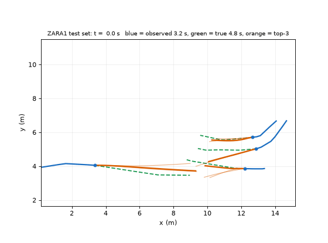
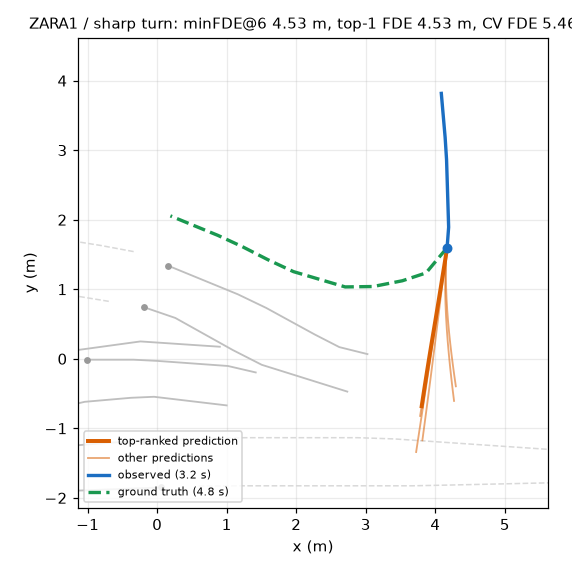
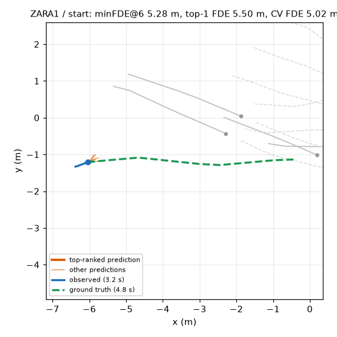
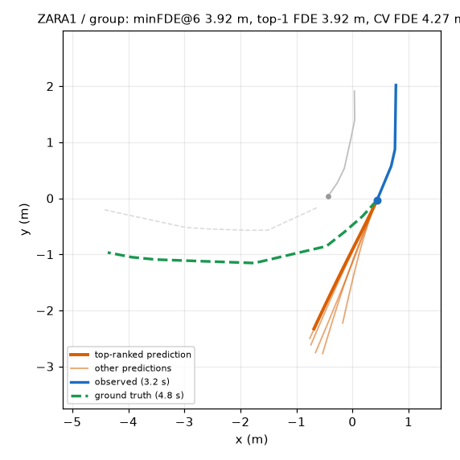

# Multi-Agent Trajectory Prediction

Multi-modal pedestrian and cyclist trajectory forecasting in PyTorch. The model combines a Transformer history encoder, a graph-attention social layer, a map encoder, TNT-style goal prediction, a CVAE, an autoregressive GRU decoder and a learned ranking network. It is evaluated against constant-velocity and LSTM baselines on the **ETH/UCY** benchmark (leave-one-scene-out) and on **nuScenes v1.0-mini**, with 3 seeds per configuration and ablations of each component.

Every number on this page comes from `runs/**/test.json`, aggregated into [`results/`](results/) by the commands under [Reproduce](#reproduce). Trained checkpoints are not stored in git; `python scripts/export_checkpoints.py` writes them to `release/` after a run.

---

## Results



*Full model on the held-out ZARA1 scene. Blue = observed 3.2 s, green = true 4.8 s, orange = the top 3 predictions (thick = top-ranked).*

> **How much to trust these numbers.** The baselines were trained with the full protocol (15 epochs, 3 seeds). The full model has **seed 0 only, on a reduced budget**: ZARA1 and ZARA2 ran 6 epochs, ETH and HOTEL were stopped at epochs 9 and 4 by an interrupted session, and UNIV early-stopped. Its best checkpoints come from epochs 2–6. The ablations are single runs on ZARA1. These results show a working pipeline end to end, not a final benchmark. `python scripts/run_benchmark.py` completes the full protocol and skips finished runs.

### ETH/UCY: average over the five leave-one-scene-out splits

8 observed steps (3.2 s) → 12 predicted steps (4.8 s) at 2.5 Hz, using the Social-GAN split files. Errors are in metres. Predictions are sorted by the model's confidence, so **@1 is the top-ranked mode**, which measures the ranking; **@6 / @20 are best-of-K**. MR@6 is the share of agents whose minFDE@6 exceeds 2 m. Baselines show mean ± std over seeds 0–2.

| Method | Seeds | minADE@1 | minFDE@1 | minADE@6 | minFDE@6 | MR@6 | minADE@20 | minFDE@20 |
|---|---|---|---|---|---|---|---|---|
| Constant velocity | 3 | **0.53** | **1.15** | 0.45 | 0.95 | 0.13 | 0.42 | 0.86 |
| LSTM enc-dec (20 modes) | 3 | 0.62 ± 0.02 | 1.32 ± 0.04 | **0.39 ± 0.01** | **0.76 ± 0.03** | **0.10 ± 0.00** | **0.26 ± 0.01** | **0.44 ± 0.02** |
| Ours, full model (reduced budget) | 1 | 0.77 | 1.51 | 0.47 | 0.90 | 0.12 | 0.33 | 0.58 |

Per scene, minADE@6 / minFDE@6 (seed 0 for every row, so the columns compare like with like):

| Method | ETH | HOTEL | UNIV | ZARA1 | ZARA2 |
|---|---|---|---|---|---|
| Constant velocity | 0.98 / 2.06 | 0.27 / 0.51 | 0.42 / 0.91 | 0.34 / 0.73 | **0.26 / 0.55** |
| LSTM enc-dec | **0.82 / 1.55** | **0.20 / 0.32** | **0.39 / 0.74** | **0.31 / 0.65** | 0.29 / 0.61 |
| Ours (reduced budget) | 0.85 / 1.57 | 0.25 / 0.44 | 0.51 / 0.99 | 0.40 / 0.84 | 0.32 / 0.65 |

**Reading the results**

- **The plain LSTM is the strongest model here.** It beats constant velocity on best-of-6 and best-of-20 (minFDE@6 0.76 vs 0.95 m). The under-trained full model sits between the two at best-of-6 (0.90 m minFDE@6). It beats constant velocity on ETH and HOTEL and falls behind on UNIV and ZARA1.
- **No learned model beats constant velocity on its top-ranked guess** (minFDE@1: 1.15 m for CV, 1.32 m for the LSTM, 1.51 m for ours). Both models learn spread-out modes for best-of-K, and their rankers do not yet pick the most likely one. Without the @1 column this weakness would be invisible.
- **Comparison with published work.** On the same split files, Social-GAN reports a best-of-20 of 0.58 / 1.18 m (ETH 0.81/1.52, HOTEL 0.72/1.61, UNIV 0.60/1.26, ZARA1 0.34/0.69, ZARA2 0.42/0.84; Gupta et al., CVPR 2018). The LSTM (0.26 / 0.44 m) and the full model (0.33 / 0.58 m) are both well below that, so the pipeline produces competitive best-of-20 numbers.
- **Note on constant velocity:** Schöller et al. (RA-L 2020) report lower constant-velocity errors (0.39 / 0.83). Their table also re-evaluates Social-GAN at 0.59 m ADE on ETH, against 0.81 m in the Social-GAN paper, so their test pipeline differs from the split files used here. Their numbers are not directly comparable.

### Ablations (ZARA1, seed 0, same 6-epoch budget as the full model)

<!-- ablation:start -->
| Variant | minADE@1 | minFDE@1 | minADE@6 | minFDE@6 | minADE@20 | minFDE@20 | ΔminFDE@6 vs full |
|---|---|---|---|---|---|---|---|
| Full model | 0.80 | 1.63 | 0.40 | 0.84 | 0.25 | 0.48 | - |
| − Transformer (LSTM history encoder) | *not run yet* | | | | | | |
| − social (GAT + decoder social attention) | 0.76 | 1.57 | 0.40 | 0.85 | 0.25 | 0.49 | +0.01 |
| − CVAE (one deterministic decode per goal) | *not run yet* | | | | | | |
| − goal predictor (CVAE samples only) | *not run yet* | | | | | | |
| − ranking network (one sample per goal) | *not run yet* | | | | | | |
<!-- ablation:end -->

The **map encoder cannot be ablated on ETH/UCY**, because the benchmark has no map data. On nuScenes, the map-expansion pack requires a nuScenes account, so no polylines are loaded there either. Any map result would therefore be meaningless, and none is claimed.

### Where the model fails (ZARA1 test set, 2,356 pedestrians)

`scripts/analyze_failures.py` tags each test agent by motion pattern, then compares the model with constant velocity on the same agents. Tags can overlap.

| Pattern | Agents | Ours minFDE@1 | Ours minFDE@6 | CV FDE | Our top-1 beats CV |
|---|---|---|---|---|---|
| all | 2,356 | 1.63 | 0.84 | 0.95 | 20% |
| walking straight | 1,952 (83%) | 1.63 | 0.72 | 0.80 | 15% |
| walking in a group | 1,234 (52%) | 1.65 | 0.75 | 0.81 | 14% |
| dense crowd (≥5 people within 3 m) | 238 (10%) | 1.71 | 0.87 | 0.94 | 13% |
| starting from standstill | 63 (3%) | 2.54 | 2.46 | 2.32 | 5% |
| sharp turn (>45°) | 37 (2%) | 3.07 | 2.94 | 3.65 | **95%** |
| stopping | 17 (1%) | 1.63 | 1.41 | 3.45 | **100%** |

| | |
|---|---|
|  |  |
|  |  |

What the cases show:

1. **Sharp turns (top left).** The pedestrian turns about 90°, but all six predictions continue within about ±15° of the current heading. The modes are too narrow to cover a turn. Even so, the model beats constant velocity on 95% of turning agents, because it has learned to curve and slow down where constant velocity runs straight on.
2. **Starting from standstill (top right).** The pedestrian is almost still for 3.2 s, then walks 5.5 m. Every prediction stays put. Nothing in the motion history signals the decision to start walking. Without scene context (a door, a crossing, a destination), no motion-only model can anticipate it.
3. **Speeding up (bottom left).** The same problem in milder form: a slow observed stretch followed by a fast walk. The top-ranked prediction stops early. The single most confident mode is biased towards slowing down, which is the main reason the model's top-1 loses to constant velocity on straight walking: its top-1 FDE is 1.63 m vs CV's 0.80 m.
4. **Groups (bottom right).** Two pedestrians turn together. The model extrapolates each one's heading and does not use the companion's motion to anticipate the turn. The social layer would need to carry exactly this signal; the "− social" ablation measures how much it contributes.

The same pattern appears on nuScenes. A cyclist riding faster than any cyclist in the training data is predicted to travel about 9 m when the true path covers about 33 m (see below). **Learned models do not extrapolate beyond the speeds they were trained on; constant velocity does by construction.**

### nuScenes v1.0-mini (pipeline check, not a benchmark)

2 Hz keyframes: 5 observed steps (2 s including the current frame) → 12 predicted steps (6 s), the nuScenes prediction-challenge horizon. Train on the official `mini_train` split (8 scenes), test on `mini_val` (2 scenes). Targets are pedestrians, plus bicycles annotated with a rider, that have a full 6 s future. Vehicles serve as social context only.

| Method | Seeds | Type | Agents | minADE@1 | minFDE@1 | minADE@6 | minFDE@6 | MR@6 |
|---|---|---|---|---|---|---|---|---|
| Constant velocity | 3 | pedestrian | 594 | **0.67** | **1.47** | 0.52 | 1.06 | 0.15 |
| LSTM enc-dec | 3 | pedestrian | 594 | 0.88 ± 0.09 | 1.85 ± 0.18 | **0.44 ± 0.01** | **0.83 ± 0.02** | **0.07 ± 0.02** |
| Ours | 1 | pedestrian | 594 | 0.91 | 1.84 | 0.65 | 1.32 | 0.18 |
| Constant velocity | 3 | cyclist | 6 | **0.93** | **1.82** | **0.93** | **1.82** | 0.50 |
| LSTM enc-dec | 3 | cyclist | 6 | 12.80 ± 0.33 | 24.25 ± 0.42 | 12.71 ± 0.26 | 24.06 ± 0.32 | 1.00 |
| Ours | 1 | cyclist | 6 | 14.32 | 26.72 | 13.65 | 25.45 | 1.00 |

The full model has 1.4M parameters but gets only 168 training samples here, and it is the weakest model on pedestrians. The cyclist rows are a single cyclist seen in 6 consecutive keyframes. That cyclist rides at 5.1–5.5 m/s, faster than every cyclist among the 46 training examples (max 4.9 m/s), and has only two observed steps. With 8 training scenes, nuScenes-mini can show that the pipeline works but cannot rank models.

### Inference time

On CPU (i7-12700H, 4 threads, batch size 1), mean over 200 test scenes per split. Timings were taken while other training jobs shared the CPU, so treat them as upper bounds.

| Method | ZARA1 (3.4 agents / scene) | UNIV (34.5 agents / scene) |
|---|---|---|
| Constant velocity | 0.1 ms | 0.4 ms |
| LSTM enc-dec | 15.6 ms | 59.5 ms |
| Ours (20 candidates, ranked) | 38.7 ms | 154.7 ms |

At about 40 ms per scene for typical pedestrian scenes, the full model runs in real time at the 2.5 Hz annotation rate on a laptop CPU. Cost grows with the number of agents, because the social attention is quadratic in it.

---

## Data audit: what was wrong before, and what changed

The first version of this project reported numbers on nuScenes-mini. An audit of the loader showed that those numbers could not be trusted:

| Issue | Before | Now |
|---|---|---|
| Timing | README said 8 past / 12 future steps at 4 Hz (2 s / 3 s) | nuScenes keyframes are 2 Hz and nothing was interpolated, so the model actually saw 3.5 s and predicted 6 s. Now stated correctly: 2 s → 6 s |
| Agent types | No category filter: 50% cars, 9% barriers/cones, 27% pedestrians, 3% bicycles. 55% of agents moved less than 0.5 m | Only pedestrians and ridden bicycles are scored; vehicles are social context only |
| Validation split | The last 10 samples of one scene that also appeared in training (neighbouring frames leak) | The official scene-level `mini_train` / `mini_val` split |
| Map | Map expansion absent → every polyline was zeros, so the map encoder only ever saw zeros | Stated explicitly. No map result is claimed |
| Frame | Centred on "agent 0", which was just the first annotation in the file | Centred on the ego vehicle pose |
| History padding | Missing history was filled by repeating the oldest box, with no mask | Padded steps are masked in the encoder |

Model and training bugs found while building the benchmark (each was verified on validation data before the final runs):

- **Decoder origin.** The decoder started every agent at the scene origin, so every agent except agent 0 had to "jump" to its own position on the first step. Each agent is now decoded relative to its own last position.
- **Ranking network.** The ranking loss stayed at exactly ln(20) for a whole training run: the network gave all candidates the same score, so the "top-6" were effectively random. The trajectory now has its own encoder, candidates are detached from the ranking loss, and the targets are soft (`softmax(−ADE/0.2 m)`).
- **Posterior candidates in the winner-takes-all pool.** Ground-truth-guided CVAE candidates were in the best-of-K pool, so they almost always won and the prior samples used at test time got little gradient. Now there is a separate reconstruction loss.
- **Goal candidates.** These were Gaussian noise (σ = 3 m) around the agent plus positions of padding agents. They are now a speed × heading grid around the constant-velocity endpoint, plus rings for slow agents, plus lane endpoints, with TNT-style offset regression.
- **Speed.** Attention was computed through dense `(B·C, N, N, 128)` tensors, and constant decoder inputs were recomputed at every step. Together these made training about 35× slower. Batches now also group scenes of similar size, because padding to the largest scene in a batch wasted most of the O(N²) social attention.

---

## Reproduce

```bash
python -m venv .venv && .venv/Scripts/activate      # or source .venv/bin/activate
pip install -r requirements.txt

python scripts/download_eth_ucy.py                  # ~10 MB, Social-GAN split files
python -m pytest tests -q                           # 16 fast checks, no GPU needed

# Every number above (resumable; finished runs are skipped)
python scripts/run_benchmark.py                     # ETH/UCY: 8 variants x 5 scenes x 3 seeds
python scripts/run_benchmark.py --dataset nuscenes_mini --variants cv lstm ours
python scripts/run_benchmark.py --aggregate-only    # rebuild results/*.md from finished runs
python scripts/ablation_table.py                    # refresh the ablation table in this README
python scripts/export_checkpoints.py                # copy slim seed-0 checkpoints into release/
```

Single runs:

```bash
python train.py --config configs/eth_ucy.yaml --set dataset.test_scene=hotel --seed 1
python train.py --config configs/eth_ucy.yaml --set model.use_social=false   # an ablation
python eval.py  --checkpoint runs/eth_ucy/hotel/ours/seed1/best.pt --out results/hotel.json
python eval.py  --config configs/eth_ucy.yaml --set model.type=cv dataset.test_scene=eth

python scripts/analyze_failures.py --checkpoint runs/eth_ucy/zara1/ours/seed0/best.pt
python scripts/make_gif.py --checkpoint runs/eth_ucy/zara1/ours/seed0/best.pt --out docs/media/zara1.gif
python inference.py --checkpoint runs/eth_ucy/zara1/ours/seed0/best.pt --index 10 --save-plot outputs/scene.png
```

Any config key can be overridden with `--set key.path=value`; no edited copies of the YAML are needed. Compute: everything here was run on a laptop CPU. One full-model run takes about 15 epochs of about 1 minute each on 6 threads.

---

## Model

```
past (N, T, 4) ─ relative to each agent's last position
   ├─► Temporal encoder   Transformer (2 layers, masked padding) ─┐
   ├─► Social encoder     2-layer GAT, edges = distance, rel. velocity ├─► fusion MLP ─► context c (N, 256)
   └─► Map encoder        per-agent polyline MLP + cross-attention ─┘
c ─► Goal predictor   kinematic + lane candidates, scored, offset-refined ─► top-6 goals
c ─► CVAE prior       z ~ p(z|c); the first sample per goal uses the prior mean
(c, goal, z) ─► GRU decoder with per-step social attention ─► 20 candidates (12 steps each)
candidates ─► ranking network (trajectory encoder + context) ─► top-K, sorted by confidence
```

Training losses (weights in `configs/*.yaml → training.loss_weights`):

| Loss | Purpose |
|---|---|
| minADE / minFDE over the 20 prior candidates | winner-takes-all multi-modality |
| reconstruction | ADE of a guided candidate (posterior z, ground-truth goal, teacher forcing); trains the CVAE posterior and goal-following |
| goal | cross-entropy toward the candidate nearest the true endpoint, plus smooth-L1 offset regression |
| KL | KL(q(z \| c, future) ‖ p(z \| c)), annealed |
| rank | soft-target cross-entropy that teaches the ranker which candidates are closest |
| diversity, NLL | optional, off by default |

The checkpoint and early stopping both use validation minADE@6 + minFDE@6, so every ablation is selected by the same criterion.

---

## Project structure

```
configs/            eth_ucy.yaml (main benchmark), nuscenes_mini.yaml
data/dataset.py     ETHUCYDataset, NuScenesDataset (JSON tables, devkit optional), DummyDataset,
                    collate with history / future / target masks, size-grouped batch sampler
models/             temporal_encoder, social_gat, map_encoder, goal_predictor, cvae, decoder,
                    trajectory (full model + ablation switches), baselines (CV, LSTM)
utils/              losses, metrics (per-agent @K errors), preprocessing, config overrides
train.py eval.py inference.py
scripts/            download_eth_ucy, run_benchmark, analyze_failures, make_gif, ablation_table,
                    export_checkpoints
tests/              pipeline invariants (every variant trains; CV is exact on linear motion; padding
                    agents do not change real predictions; @1 uses the top-ranked mode; ...)
results/            aggregated tables (*.md) and raw summaries (*.json)
release/            trained checkpoints, written locally by export_checkpoints.py (not in git)
docs/               failure-case plots and the prediction GIF used in this README
demo.py demo_pedestrian.py   interactive HTML pages for nuScenes-mini predictions
```

## References

- Gupta et al., *Social GAN: Socially Acceptable Trajectories with Generative Adversarial Networks*, CVPR 2018. Source of the ETH/UCY split files and the best-of-20 protocol.
- Schöller et al., *What the Constant Velocity Model Can Teach Us About Pedestrian Motion Prediction*, RA-L 2020.
- Zhao et al., *TNT: Target-driveN Trajectory Prediction*, CoRL 2020. Goal candidates plus offset regression.
- Caesar et al., *nuScenes: A multimodal dataset for autonomous driving*, CVPR 2020.
