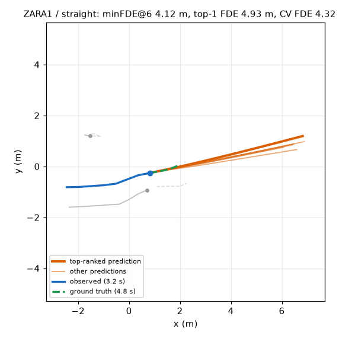

# Multi-Agent Trajectory Prediction

Multi-modal pedestrian and cyclist trajectory forecasting in PyTorch. The model combines a Transformer history encoder, a graph-attention social layer, a map encoder, TNT-style goal prediction, a CVAE, an autoregressive GRU decoder and a learned ranking network. It is evaluated against constant-velocity and LSTM baselines on the **ETH/UCY** benchmark (leave-one-scene-out) and on **nuScenes v1.0-mini**, with 3 seeds per configuration and ablations of each component.

Every number on this page comes from `runs/**/test.json`, aggregated into [`results/`](results/) by the commands under [Reproduce](#reproduce). Trained checkpoints are not stored in git; `python scripts/export_checkpoints.py` writes them to `release/` after a run.

---

## Results


*Full model (seed 0) on the held-out ZARA1 scene. Blue = observed 3.2 s, green = true 4.8 s, orange = the top 3 predictions (thick = top-ranked).*

> **How much to trust these numbers.** Every row uses the full protocol: 3 seeds, up to 15 epochs, early stopping after 6 epochs without improvement, and the checkpoint chosen on validation data only. The ablations were run on ZARA1 only. Two caveats. In 7 of the 15 ETH/UCY full-model runs the best checkpoint came from epoch 14 or 15, so the model may be under-trained at this budget; that has not been tested. ETH seed 2 early-stopped at epoch 7 (best epoch 2), which is why its spread is larger.

### ETH/UCY: average over the five leave-one-scene-out splits

8 observed steps (3.2 s) → 12 predicted steps (4.8 s) at 2.5 Hz, using the Social-GAN split files. Errors are in metres, mean ± std over seeds 0–2. Predictions are sorted by the model's confidence, so **@1 is the top-ranked mode**, which measures the ranking; **@6 / @20 are best-of-K**. MR@6 is the share of agents whose minFDE@6 exceeds 2 m.

| Method | Seeds | minADE@1 | minFDE@1 | minADE@6 | minFDE@6 | MR@6 | minADE@20 | minFDE@20 |
|---|---|---|---|---|---|---|---|---|
| Constant velocity | 3 | **0.53** | **1.15** | 0.45 | 0.95 | 0.13 | 0.42 | 0.86 |
| LSTM enc-dec (20 modes) | 3 | 0.61 ± 0.02 | 1.30 ± 0.04 | **0.39 ± 0.01** | **0.76 ± 0.03** | **0.10 ± 0.00** | **0.26 ± 0.01** | **0.44 ± 0.01** |
| Ours, full model | 3 | 0.64 ± 0.02 | 1.28 ± 0.00 | 0.45 ± 0.01 | 0.87 ± 0.05 | 0.12 ± 0.01 | 0.31 ± 0.01 | 0.56 ± 0.03 |

Per scene, minADE@6 / minFDE@6:

| Method | ETH | HOTEL | UNIV | ZARA1 | ZARA2 |
|---|---|---|---|---|---|
| Constant velocity | 0.98 / 2.06 | 0.27 / 0.51 | 0.42 / 0.91 | 0.34 / 0.72 | 0.26 / 0.55 |
| LSTM enc-dec | **0.80 ± 0.02 / 1.53 ± 0.05** | **0.21 ± 0.02 / 0.39 ± 0.09** | **0.39 ± 0.01 / 0.75 ± 0.01** | **0.31 ± 0.01 / 0.64 ± 0.02** | **0.25 ± 0.04 / 0.52 ± 0.08** |
| Ours | 0.84 ± 0.04 / 1.57 ± 0.21 | 0.25 ± 0.01 / 0.44 ± 0.03 | 0.50 ± 0.00 / 1.01 ± 0.02 | 0.36 ± 0.00 / 0.76 ± 0.01 | 0.27 ± 0.01 / 0.58 ± 0.01 |

**Reading the results**

- **The plain LSTM is the strongest model here**, on every scene at best-of-6 and best-of-20 (average minFDE@6 0.76 m). The full model comes second at best-of-6 (0.87 m). It beats constant velocity on ETH and HOTEL and falls behind it on UNIV, ZARA1 and ZARA2.
- **No learned model beats constant velocity on its top-ranked guess** (minFDE@1: 1.15 m for CV, 1.28 m for ours, 1.30 m for the LSTM). Both models learn spread-out modes for best-of-K, and their rankers do not pick the most likely one. Without the @1 column this weakness would be invisible.
- **The extra components do not pay for themselves yet.** On ZARA1 (table below), removing the CVAE, the goal predictor or the ranking network each *lowers* minFDE@6 by 0.05–0.07 m, removing the social layer changes nothing, and only removing the Transformer makes it slightly worse (+0.04 ± 0.04 m, within seed noise). Finding out why, using validation data only, is the next step.
- **Comparison with published work.** On the same split files, Social-GAN reports a best-of-20 of 0.58 / 1.18 m (Gupta et al., CVPR 2018). Every method here is below that, *including constant velocity with sampled variations* (0.42 / 0.86 m). So this comparison says more about evaluation details than about the models, and it should not be read as beating Social-GAN.
- **Note on constant velocity:** Schöller et al. (RA-L 2020) report lower constant-velocity errors (0.39 / 0.83). Their table also re-evaluates Social-GAN at 0.59 m ADE on ETH, against 0.81 m in the Social-GAN paper, so their test pipeline differs from the split files used here. Their numbers are not directly comparable.

### Ablations (ZARA1, 3 seeds each, same protocol as the full model)

<!-- ablation:start -->
| Variant | Seeds | minADE@1 | minFDE@1 | minADE@6 | minFDE@6 | minADE@20 | minFDE@20 | ΔminFDE@6 vs full |
|---|---|---|---|---|---|---|---|---|
| Full model | 3 | 0.62 ± 0.01 | 1.28 ± 0.02 | 0.36 ± 0.00 | 0.76 ± 0.01 | 0.24 ± 0.01 | 0.45 ± 0.01 | - |
| − Transformer (LSTM history encoder) | 3 | 0.70 ± 0.09 | 1.42 ± 0.15 | 0.39 ± 0.03 | 0.79 ± 0.04 | 0.26 ± 0.05 | 0.48 ± 0.08 | +0.04 ± 0.04 |
| − social (GAT + decoder social attention) | 3 | 0.61 ± 0.01 | 1.28 ± 0.03 | 0.36 ± 0.00 | 0.75 ± 0.01 | 0.24 ± 0.00 | 0.45 ± 0.01 | -0.00 ± 0.02 |
| − CVAE (one deterministic decode per goal) | 3 | 0.66 ± 0.05 | 1.36 ± 0.09 | 0.34 ± 0.00 | 0.70 ± 0.01 | 0.24 ± 0.01 | 0.46 ± 0.02 | -0.05 ± 0.00 |
| − goal predictor (CVAE samples only) | 3 | 0.57 ± 0.02 | 1.24 ± 0.04 | 0.33 ± 0.01 | 0.70 ± 0.01 | 0.22 ± 0.00 | 0.43 ± 0.00 | -0.05 ± 0.02 |
| − ranking network (one sample per goal) | 3 | 0.54 ± 0.15 | 1.12 ± 0.24 | 0.34 ± 0.02 | 0.68 ± 0.02 | 0.25 ± 0.02 | 0.46 ± 0.02 | -0.07 ± 0.02 |
<!-- ablation:end -->

The **map encoder cannot be ablated on ETH/UCY**, because the benchmark has no map data. On nuScenes, the map-expansion pack requires a nuScenes account, so no polylines are loaded there either. Any map result would therefore be meaningless, and none is claimed.

### Where the model fails (ZARA1 test set, seed-0 model, 2,356 pedestrians)

`scripts/analyze_failures.py` tags each test agent by motion pattern, then compares the model with constant velocity on the same agents. Tags can overlap. Raw numbers: [`results/failures_zara1.json`](results/failures_zara1.json).

| Pattern | Agents | Ours minFDE@1 | Ours minFDE@6 | CV FDE | Our top-1 beats CV |
|---|---|---|---|---|---|
| all | 2,356 | 1.29 | 0.76 | 0.95 | 23% |
| walking straight | 1,952 (83%) | 1.21 | 0.62 | 0.80 | 20% |
| walking in a group | 1,234 (52%) | 1.17 | 0.62 | 0.81 | 23% |
| dense crowd (≥5 people within 3 m) | 238 (10%) | 1.18 | 0.70 | 0.94 | 29% |
| starting from standstill | 63 (3%) | 2.45 | 2.32 | 2.32 | 17% |
| sharp turn (>45°) | 37 (2%) | 3.21 | 2.89 | 3.65 | **97%** |
| stopping | 17 (1%) | 3.43 | 2.68 | 3.45 | 41% |

| | |
|---|---|
|  |  |
|  |  |

Each plot is the worst case for its tag. What they show:

1. **Sharp turn (top left).** The pedestrian turns back sharply to the left, but all six predictions continue in a narrow fan along the current heading. The modes are too narrow to cover a turn. Even so, the model beats constant velocity on 97% of turning agents, because it has learned to curve and slow down where constant velocity runs straight on.
2. **Starting from standstill (top right).** The pedestrian is almost still for 3.2 s, then walks about 5.5 m. Every prediction stays put. Nothing in the motion history signals the decision to start walking. Without scene context (a door, a crossing, a destination), no motion-only model can anticipate it.
3. **Sudden stop (bottom row).** The worst cases for "walking straight" and "walking in a group" are the same situation, apparently the same pedestrian one frame apart: a fast walk that stops after about 1 m. Every prediction, and constant velocity, carries on for about 6 m. As with starting, the history gives no warning.

The common thread is that the worst errors come from **changes of intent** (start, stop, turn) that the motion history does not reveal. The table also shows where the top-1 problem comes from: on ordinary straight walking, the top-ranked prediction loses to constant velocity 80% of the time (minFDE@1 1.21 m vs 0.80 m), even though the best of six is better (0.62 m).

### nuScenes v1.0-mini (pipeline check, not a benchmark)

2 Hz keyframes: 5 observed steps (2 s including the current frame) → 12 predicted steps (6 s), the nuScenes prediction-challenge horizon. Train on 7 of the 8 official `mini_train` scenes, validate on the 8th (`scene-1100`, used for checkpoint choice and early stopping), and test on the official `mini_val` (2 scenes), which is never used for selection. Targets are pedestrians, plus bicycles annotated with a rider, that have a full 6 s future. Vehicles serve as social context only.

| Method | Seeds | Type | Agents | minADE@1 | minFDE@1 | minADE@6 | minFDE@6 | MR@6 |
|---|---|---|---|---|---|---|---|---|
| Constant velocity | 3 | pedestrian | 594 | **0.67** | **1.47** | 0.52 | 1.06 | 0.15 |
| LSTM enc-dec | 3 | pedestrian | 594 | 0.88 ± 0.09 | 1.82 ± 0.16 | **0.49 ± 0.02** | **0.91 ± 0.06** | **0.09 ± 0.03** |
| Ours | 3 | pedestrian | 594 | 1.04 ± 0.03 | 2.07 ± 0.06 | 0.64 ± 0.04 | 1.29 ± 0.09 | 0.18 ± 0.01 |
| Constant velocity | 3 | cyclist | 6 | **0.93** | **1.82** | **0.93** | **1.82** | **0.50** |
| LSTM enc-dec | 3 | cyclist | 6 | 12.77 ± 0.14 | 24.21 ± 0.26 | 12.77 ± 0.14 | 24.21 ± 0.26 | 1.00 |
| Ours | 3 | cyclist | 6 | 14.24 ± 1.83 | 26.46 ± 3.60 | 13.19 ± 0.25 | 24.47 ± 0.56 | 1.00 |

The full model has 1.4M parameters but only 141 training samples here (1,501 target pedestrians, 46 cyclists), and it is the weakest model on pedestrians. The cyclist rows are one cyclist seen in 6 consecutive keyframes, riding at 5.0–5.5 m/s, faster than every cyclist in the training data (max 4.9 m/s). An end-point error of about 24 m on a path of roughly 30 m means both learned models predict the cyclist covering only a fraction of the distance. Whether that is only the unseen speed, or also a data problem, has not been checked yet. With 8 training scenes, nuScenes-mini can show that the pipeline works but cannot rank models.

### Inference time

On CPU (i7-12700H, 4 threads, batch size 1), seed-0 checkpoints, mean over 200 test scenes, measured with nothing else running ([`results/latency_2026-11-27/`](results/latency_2026-11-27/)). The "ms / scene" column in `results/*_results.md` was recorded while three training jobs shared the CPU and is not reliable.

| Method | ZARA1 (3.4 agents / scene) | UNIV (34.5 agents / scene) |
|---|---|---|
| Constant velocity | 0.1 ms | 0.2 ms |
| LSTM enc-dec | 2.5 ms | 14.0 ms |
| Ours (20 candidates, ranked) | 7.8 ms | 30.0 ms |

The full model runs in real time at the 2.5 Hz annotation rate on a laptop CPU, even in UNIV's crowded scenes. Cost grows with the number of agents, because the social attention is quadratic in it.

---

## Data audit: what was wrong before, and what changed

The first version of this project reported numbers on nuScenes-mini. An audit of the loader showed that those numbers could not be trusted:

| Issue | Before | Now |
|---|---|---|
| Timing | README said 8 past / 12 future steps at 4 Hz (2 s / 3 s) | nuScenes keyframes are 2 Hz and nothing was interpolated, so the model actually saw 3.5 s and predicted 6 s. Now stated correctly: 2 s → 6 s |
| Agent types | No category filter: 50% cars, 9% barriers/cones, 27% pedestrians, 3% bicycles. 55% of agents moved less than 0.5 m | Only pedestrians and ridden bicycles are scored; vehicles are social context only |
| Validation split | The last 10 samples of one scene that also appeared in training (neighbouring frames leak). A later version used `mini_val` for both checkpoint selection and testing | Scene-level: 7 `mini_train` scenes for training, `scene-1100` for validation, the official `mini_val` for testing only |
| Map | Map expansion absent → every polyline was zeros, so the map encoder only ever saw zeros | Stated explicitly. No map result is claimed |
| Frame | Centred on "agent 0", which was just the first annotation in the file | Centred on the ego vehicle pose |
| History padding | Missing history was filled by repeating the oldest box, with no mask | Padded steps are masked in the encoder |

Model and training bugs found while building the benchmark (each was verified on validation data before the final runs):

- **Decoder origin.** The decoder started every agent at the scene origin, so every agent except agent 0 had to "jump" to its own position on the first step. Each agent is now decoded relative to its own last position.
- **Ranking network.** The ranking loss stayed at exactly ln(20) for a whole training run: the network gave all candidates the same score, so the "top-6" were effectively random. The trajectory now has its own encoder, candidates are detached from the ranking loss, and the targets are soft (`softmax(−ADE/0.2 m)`).
- **Posterior candidates in the winner-takes-all pool.** Ground-truth-guided CVAE candidates were in the best-of-K pool, so they almost always won and the prior samples used at test time got little gradient. Now there is a separate reconstruction loss.
- **Goal candidates.** These were Gaussian noise (σ = 3 m) around the agent plus positions of padding agents. They are now a speed × heading grid around the constant-velocity endpoint, plus rings for slow agents, plus lane endpoints, with TNT-style offset regression.
- **Speed.** Attention was computed through dense `(B·C, N, N, 128)` tensors, and constant decoder inputs were recomputed at every step. Together these made training about 35× slower. Batches now also group scenes of similar size, because padding to the largest scene in a batch wasted most of the O(N²) social attention.

Found after the first full benchmark run (27 Nov 2026):

- **Candidate pool dropped the last goal.** With 6 goals and 20 candidates, the code gave each goal a block of 4 candidates and cut the list at 20, so the 6th goal never got a trajectory, and the "− ranking network" ablation crashed. Candidates now cycle through the goals, and a regression test uses the real sizes (the old test config used 12 candidates, which divides evenly by 6 and hid the bug). Every affected run was re-trained. The fix barely moved the full model: average minFDE@6 went from 0.88 to 0.87 m, within seed noise. The pre-fix results are kept in [`results/_before_goal_fix_2026-11-27/`](results/_before_goal_fix_2026-11-27/).

---

## Reproduce

```bash
python -m venv .venv && .venv/Scripts/activate      # or source .venv/bin/activate
pip install -r requirements.txt

python scripts/download_eth_ucy.py                  # ~10 MB, Social-GAN split files
python -m pytest tests -q                           # 22 fast checks, no GPU needed

# The exact commands behind every table above (resumable; finished runs are skipped).
# Ablations first: the second command re-aggregates the full ETH/UCY table.
python scripts/run_benchmark.py --scenes zara1 --variants no_transformer no_social no_cvae no_goals no_ranking
python scripts/run_benchmark.py --variants cv lstm ours
python scripts/run_benchmark.py --dataset nuscenes_mini --variants cv lstm ours
python scripts/ablation_table.py --scene zara1 --seeds 0 1 2   # refresh the ablation table in this README
python scripts/run_benchmark.py --aggregate-only    # rebuild results/*.md from finished runs
python scripts/export_checkpoints.py                # copy slim seed-0 checkpoints into release/
```

Single runs:

```bash
python train.py --config configs/eth_ucy.yaml --set dataset.test_scene=hotel --seed 1
python train.py --config configs/eth_ucy.yaml --set model.use_social=false   # an ablation
python eval.py  --checkpoint runs/eth_ucy/hotel/ours/seed1/best.pt --out results/hotel.json
python eval.py  --config configs/eth_ucy.yaml --set model.type=cv dataset.test_scene=eth

python scripts/analyze_failures.py --checkpoint runs/eth_ucy/zara1/ours/seed0/best.pt
python scripts/make_gif.py --checkpoint runs/eth_ucy/zara1/ours/seed0/best.pt --out docs/media/zara1.gif
python inference.py --checkpoint runs/eth_ucy/zara1/ours/seed0/best.pt --index 10 --save-plot outputs/scene.png
```

Any config key can be overridden with `--set key.path=value`; no edited copies of the YAML are needed. Compute: everything here was run on a laptop CPU (i7-12700H). With 3 runs in parallel at 4 threads each, one full-model ETH/UCY run took 11–38 minutes.

---

## Model

```
past (N, T, 4) ─ relative to each agent's last position
   ├─► Temporal encoder   Transformer (2 layers, masked padding) ─┐
   ├─► Social encoder     2-layer GAT, edges = distance, rel. velocity ├─► fusion MLP ─► context c (N, 256)
   └─► Map encoder        per-agent polyline MLP + cross-attention ─┘
c ─► Goal predictor   kinematic + lane candidates, scored, offset-refined ─► top-6 goals
c ─► CVAE prior       z ~ p(z|c); the first sample per goal uses the prior mean
(c, goal, z) ─► GRU decoder with per-step social attention ─► 20 candidates (12 steps each),
                assigned to the 6 goals in turn
candidates ─► ranking network (trajectory encoder + context) ─► top-K, sorted by confidence
```

Training losses (weights in `configs/*.yaml → training.loss_weights`):

| Loss | Purpose |
|---|---|
| minADE / minFDE over the 20 prior candidates | winner-takes-all multi-modality |
| reconstruction | ADE of a guided candidate (posterior z, ground-truth goal, teacher forcing); trains the CVAE posterior and goal-following |
| goal | cross-entropy toward the candidate nearest the true endpoint, plus smooth-L1 offset regression |
| KL | KL(q(z \| c, future) ‖ p(z \| c)), annealed |
| rank | soft-target cross-entropy that teaches the ranker which candidates are closest |
| diversity, NLL | optional, off by default |

The checkpoint and early stopping both use validation minADE@6 + minFDE@6, so every ablation is selected by the same criterion.

---

## Project structure

```
configs/            eth_ucy.yaml (main benchmark), nuscenes_mini.yaml
data/dataset.py     ETHUCYDataset, NuScenesDataset (JSON tables, devkit optional), DummyDataset,
                    collate with history / future / target masks, size-grouped batch sampler
models/             temporal_encoder, social_gat, map_encoder, goal_predictor, cvae, decoder,
                    trajectory (full model + ablation switches), baselines (CV, LSTM)
utils/              losses, metrics (per-agent @K errors), preprocessing, config overrides
train.py eval.py inference.py
scripts/            download_eth_ucy, run_benchmark, analyze_failures, make_gif, ablation_table,
                    export_checkpoints
tests/              pipeline invariants (every variant trains; CV is exact on linear motion; padding
                    agents do not change real predictions; @1 uses the top-ranked mode; ...)
results/            aggregated tables (*.md) and raw summaries (*.json)
release/            trained checkpoints, written locally by export_checkpoints.py (not in git)
docs/               failure-case plots and the prediction GIF used in this README
demo.py demo_pedestrian.py   build interactive HTML pages locally (not in git: they embed nuScenes data)
```

## References

- Gupta et al., *Social GAN: Socially Acceptable Trajectories with Generative Adversarial Networks*, CVPR 2018. Source of the ETH/UCY split files and the best-of-20 protocol.
- Schöller et al., *What the Constant Velocity Model Can Teach Us About Pedestrian Motion Prediction*, RA-L 2020.
- Zhao et al., *TNT: Target-driveN Trajectory Prediction*, CoRL 2020. Goal candidates plus offset regression.
- Caesar et al., *nuScenes: A multimodal dataset for autonomous driving*, CVPR 2020.
